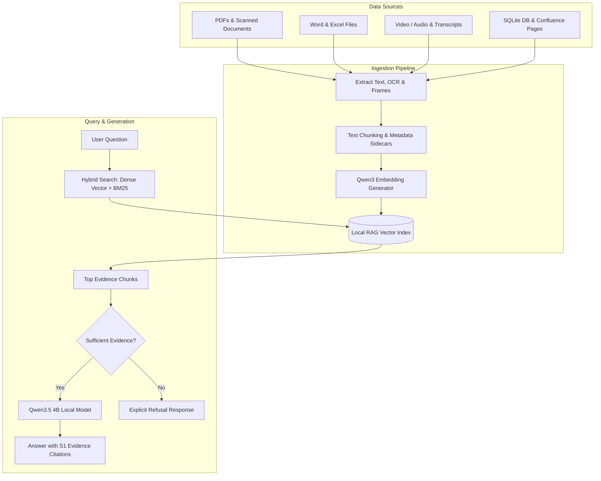

# Northstar Local RAG Prototype

[](https://www.python.org/)
[](https://streamlit.io/)
[](https://ollama.com/)
[](https://www.docker.com/)
[](LICENSE)

An enterprise-ready, privacy-focused **Local Retrieval-Augmented Generation (RAG)** prototype for intelligent company knowledge base search and QA. Operating 100% locally via **Ollama**, this prototype handles multimodal document parsing (PDFs, scanned OCR, Word, Excel, SQLite, Video, Audio, and Confluence Cloud pages) with zero data leaving your local machine.

---

## Key Features

- **100% Local & Private**: Powered by local **Qwen3.5 4B** (LLM) and **Qwen3 Embedding 0.6B** via Ollama. No external API keys or cloud dependencies required for core retrieval.
- **Multimodal Data Support**: 
  - **Documents**: Word (`.docx`), PDF (`.pdf`), Scanned PDF OCR, Text (`.txt`, `.md`), CSV, JSON.
  - **Spreadsheets & Databases**: Excel (`.xlsx`) sheet summaries & read-only SQLite (`.db`, `.sqlite`) inspection.
  - **Audio & Video**: Local Faster-Whisper transcription, VTT subtitle ingestion, and sampled video frame visual analysis.
  - **Confluence Sync**: Built-in REST connector to pull Confluence Cloud spaces and attachments.
- **Hybrid Semantic + Keyword Search**: Combines dense vector similarity with BM25 keyword matching for maximum recall and precision.
- **Strict Evidence Grounding & Refusals**: Every answer contains source citations (e.g. `[S1]`). If the provided document context lacks sufficient evidence, the assistant explicitly refuses to hallucinate.
- **Containerized & Portable**: Complete support for native local execution or single-command deployment via Docker & Docker Compose.

---

## Architecture & Data Flow



---

## Tech Stack & Models

| Component | Technology / Model | Description |
| :--- | :--- | :--- |
| **User Interface** | Streamlit | Interactive web chat interface & SQLite dataset explorer |
| **Local LLM Engine** | Ollama | Manages local model inference without external APIs |
| **Instruction Model** | `qwen3.5:4b` | Local base instruction model for reasoning & response synthesis |
| **Embedding Model** | `qwen3-embedding:0.6b` | Multilingual vector embeddings for semantic document search |
| **Audio/Video Transcriber** | Faster-Whisper | Local automatic speech recognition (ASR) for audio/video |
| **Vision / OCR** | Qwen3.5 Vision | Local image OCR & diagram analysis for scanned documents |
| **Containerization** | Docker & Docker Compose | Containerized application setup connected to host Ollama |

---

## Quick Start

### 1. Windows (Native)

1. Install [Python 3.11 or 3.12](https://www.python.org/downloads/) (Select **Add Python to PATH**).
2. Install and launch [Ollama for Windows](https://ollama.com/download).
3. Open a terminal in the project directory and run setup:
   ```cmd
   setup_windows.bat
   ```
   *(This creates a virtual environment, installs dependencies, and pulls required models).*
4. Launch the application:
   ```cmd
   run_windows.bat
   ```
5. Open your browser at `http://localhost:8501`, click **Build / rebuild index**, and start asking questions!

---

### 2. macOS & Linux (Native)

1. Install Python 3.11+ and [Ollama](https://ollama.com/download).
2. Make scripts executable and run setup:
   ```bash
   chmod +x setup_mac_linux.sh run_mac_linux.sh
   ./setup_mac_linux.sh
   ```
3. Run the application:
   ```bash
   ./run_mac_linux.sh
   ```

---

### 3. Docker Deployment

Make sure [Docker Desktop](https://www.docker.com/) and [Ollama](https://ollama.com/) are running on your host machine.

1. Build and start the container stack:
   ```bash
   docker compose up --build -d
   ```
2. Open your browser to:
   ```text
   http://localhost:8501
   ```
3. View logs or stop the stack:
   ```bash
   # View logs
   docker compose logs -f web

   # Stop container
   docker compose down
   ```

> **Note**: The Docker container automatically connects to your host machine's Ollama instance at `http://host.docker.internal:11434`, reusing your existing local models without re-downloading them inside the container.

---

## Sample Benchmark Questions

Try asking the following test queries once your index is built:

- 💬 *What are the standard office hours?*
- 💬 *What approvals are required before buying remote-work equipment?*
- 💬 *How quickly must suspected phishing be reported?*
- 💬 *What are the four information-classification levels?*
- 💬 *How many P1 tickets are in the workbook?*
- 💬 *How many service requests are currently open in the database?*
- ❌ *What dental insurance plan does Northstar provide?* *(Expected result: Explicit Refusal due to lack of evidence)*

---

## Confluence Cloud Sync (Optional)

To test syncing with a private test space in Confluence Cloud:

1. Copy `.env.example` to `.env`:
   ```bash
   cp .env.example .env
   ```
2. Configure your credentials in `.env`:
   ```env
   CONFLUENCE_BASE_URL=https://your-company.atlassian.net
   CONFLUENCE_EMAIL=you@company.com
   CONFLUENCE_API_TOKEN=your-token
   CONFLUENCE_SPACE_KEY=YOURSPACEKEY
   CONFLUENCE_OUTPUT_DIR=data/confluence
   CONFLUENCE_DOWNLOAD_ATTACHMENTS=true
   CONFLUENCE_ATTACHMENT_MAX_MB=250
   ```
3. Execute the sync and rebuild the index:
   ```bash
   python scripts/sync_confluence.py
   python scripts/build_index.py
   ```

---

## Advanced Media Processing (OCR & Video)

When **Build / rebuild index** is executed:
- **Scanned PDFs & Images**: Pages with fewer than 50 characters trigger local vision OCR via `qwen3.5:4b`.
- **Audio & Video Files**: Transcribed via Faster-Whisper. Video files sample frames every 15 seconds for slide and visual content analysis.
- **Caching**: Media processing outputs are cached alongside source files as `.media.json` sidecar files to prevent redundant computation.

To process media standalone via CLI:
```bash
python scripts/process_media.py
```

---

## Testing & Evaluation

Run automated unit tests:
```bash
python -m pytest -q
```

Evaluate retrieval performance against the included question evaluation benchmark (`rag_evaluation_questions.json`):
```bash
python scripts/evaluate_retrieval.py
```

---

## Project Structure

```text
Northstar_Local_RAG_Prototype/
├── app.py                      # Main Streamlit web app
├── Dockerfile                  # Container definition
├── docker-compose.yml          # Container orchestration
├── .dockerignore               # Build context filter
├── .env.example                # Environment variable configuration template
├── northstar_rag/              # Core RAG engine module
│   ├── chunking.py             # Document splitting & token management
│   ├── config.py               # Settings loader
│   ├── confluence.py           # Confluence REST sync connector
│   ├── index_store.py          # Vector index storage & persistence
│   ├── loaders.py              # Multimodal file parsers (Word, Excel, PDF, SQL)
│   ├── media.py                # Whisper ASR & Vision OCR processor
│   ├── models.py               # Data structures
│   ├── ollama_client.py        # Ollama HTTP API client wrapper
│   ├── retrieval.py            # Hybrid semantic + BM25 keyword search
│   ├── service.py              # Main QA & RAG orchestration logic
│   └── sql_tool.py             # Read-only SQLite query explorer
├── sample_data/                # Dummy test dataset for Northstar Inc.
├── scripts/                    # CLI helper utility scripts
└── tests/                      # Automated pytest suite
```

---

## Limitations & Future Enhancements

- **Sampled Video Analysis**: Video frame analysis relies on periodic time sampling rather than full-stream decoding.
- **Model-Based OCR**: Vision model OCR outputs should be spot-checked for high-impact numeric values.
- **Enterprise Controls**: This prototype is designed for local evaluation. Production rollout should incorporate SSO authentication, enterprise ACL permission filtering, and central logging.

---

## License

This project is licensed under the MIT License - see the [LICENSE](LICENSE) file for details.
