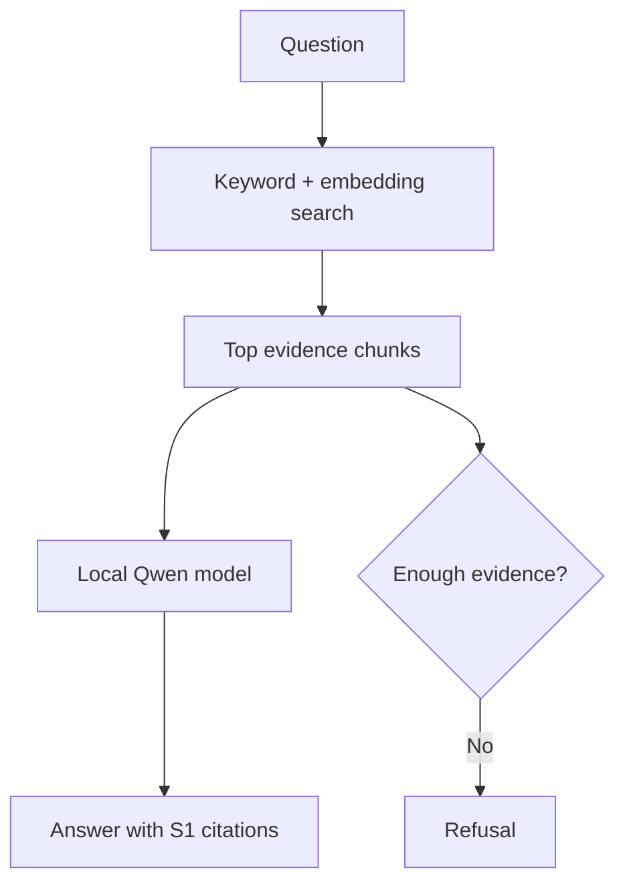

# Northstar local RAG prototype

This is a runnable learning prototype for a company knowledge chatbot. It uses:

- a local **Qwen3.5 4B** base/instruction model through Ollama;
- local multilingual embeddings through **Qwen3 Embedding 0.6B**;
- Word, PDF, scanned-PDF OCR, images, Excel, video/audio, SQLite, text, CSV, JSON, and Confluence Cloud pages;
- hybrid semantic + keyword retrieval;
- evidence citations on every supported answer;
- an explicit refusal when the sources do not support an answer;
- a separate read-only SQLite explorer.

The included Northstar data is entirely fictional.

## Fastest start on Windows

1. Install [Python 3.11 or 3.12](https://www.python.org/downloads/) and select **Add Python to PATH** during installation.
2. Install [Ollama for Windows](https://ollama.com/download).
3. Extract this ZIP to a normal folder such as `C:\Users\YourName\northstar-rag`.
4. Double-click `setup_windows.bat`. It creates a private Python environment, installs the app, and downloads both local models.
5. Double-click `run_windows.bat`.
6. Your browser opens the app. Click **Build / rebuild index** once.
7. Ask: `How many unused annual-leave days may be carried forward?`

The first setup downloads several gigabytes. Later runs are local and much faster.

## macOS or Linux

Install Python and [Ollama](https://ollama.com/download), then run:

```bash
chmod +x setup_mac_linux.sh run_mac_linux.sh
./setup_mac_linux.sh
./run_mac_linux.sh
```

## Running with Docker

Make sure [Docker Desktop](https://www.docker.com/) and [Ollama](https://ollama.com/) are running on your host machine.

1. Build and launch the container stack:
```bash
docker compose up --build -d
```
2. Open your browser and navigate to:
```text
http://localhost:8501
```
3. To view application logs:
```bash
docker compose logs -f web
```
4. To stop the container:
```bash
docker compose down
```

The container automatically connects to your host Ollama models at `http://host.docker.internal:11434`.


## What happens when you ask a question



Documents are parsed and split into overlapping chunks. Ollama converts the chunks and the question into embeddings. The retriever combines cosine similarity with BM25 keyword matching. Only the best evidence is supplied to the chat model. Source text is treated as untrusted data so instructions found inside a document are ignored.

## Useful test questions

- What are the standard office hours?
- What approvals are required before buying remote-work equipment?
- How quickly must suspected phishing be reported?
- What are the four information-classification levels?
- How many P1 tickets are in the workbook?
- How many service requests are currently open in the database?
- What dental insurance plan does Northstar provide? *(should refuse)*

The full 30-question set is in `sample_data/northstar_rag_dummy_dataset/03_Evaluation`.

## Confluence Cloud learning sync

Do not connect real company content until your company has approved where AI processing may occur, who may access the index, and how data is retained. This prototype has no enterprise permission mirroring.

For a private test space containing only the fictional pages:

1. Copy `.env.example` to `.env` if setup did not already do so.
2. Create a Confluence API token for your own test account.
3. Fill these fields in `.env`:

```text
CONFLUENCE_BASE_URL=https://your-company.atlassian.net
CONFLUENCE_EMAIL=you@company.com
CONFLUENCE_API_TOKEN=your-token
CONFLUENCE_SPACE_KEY=YOURSPACEKEY
CONFLUENCE_OUTPUT_DIR=data/confluence
CONFLUENCE_DOWNLOAD_ATTACHMENTS=true
CONFLUENCE_ATTACHMENT_MAX_MB=250
```

4. With the Python environment active, run:

```bash
python scripts/sync_confluence.py
python scripts/build_index.py
```

The connector downloads current pages and supported page attachments through the Confluence REST API. This includes documents/data plus PNG, JPG, TIFF, BMP, WebP, MP4, MOV, MKV, WebM, AVI, MP3, WAV, M4A, FLAC, AAC, and OGG. Files larger than 250 MB are skipped by default; change `CONFLUENCE_ATTACHMENT_MAX_MB` if needed.

Downloaded attachments are stored under `data/confluence/attachments/PAGE_ID/`. A hidden sidecar records the attachment ID, version, parent page, and Confluence URL so retrieval citations can link back to Confluence. Unchanged attachment versions are not downloaded again. The sync command reports every skipped or failed attachment before the index is rebuilt.

The API token stays in `.env`, which is excluded from Git. Basic authentication is acceptable for this small personal script; a company rollout should use approved OAuth/service-account architecture and enforce each user's Confluence permissions before retrieval.

## Image OCR, scanned PDFs, and video understanding

Run `setup_windows.bat` again after upgrading. It installs the local media components. No additional cloud AI key is required.

When **Build / rebuild index** runs:

1. Qwen3.5 Vision extracts visible text and factual visual information from image attachments.
2. Text-poor PDF pages are rendered locally and sent to the same local vision model for OCR and diagram analysis.
3. Faster-Whisper transcribes speech from video/audio with timestamps. If a matching VTT already exists, the supplied transcript is used instead.
4. Video frames are sampled every 15 seconds by default. Qwen3.5 extracts slide text and describes meaningful visual information from those frames.
5. The extracted evidence is embedded and receives image/page/timestamp citations like every other source.

The first automatic transcription downloads the selected Whisper model. After that, OCR, transcription, embeddings, and answering run locally. Media analysis is cached beside each source as a hidden `.media.json` file and is repeated only when the source changes.

Relevant `.env` controls:

```text
MEDIA_AUTO_PROCESS_ON_INDEX=true
OCR_VISION_MODEL=qwen3.5:4b
PDF_OCR_MIN_CHARS=50
WHISPER_MODEL=small
WHISPER_DEVICE=cpu
WHISPER_COMPUTE_TYPE=int8
WHISPER_LANGUAGE=auto
VIDEO_FRAME_ANALYSIS=true
VIDEO_FRAME_INTERVAL_SECONDS=15
VIDEO_MAX_FRAMES=40
```

To preprocess media separately before opening the app:

```bash
python scripts/process_media.py
```

## Model choices

The defaults are in `.env`:

```text
OLLAMA_CHAT_MODEL=qwen3.5:4b
OLLAMA_EMBED_MODEL=qwen3-embedding:0.6b
```

If the 4B model is slow on your computer, try `qwen3.5:2b`. If you have more memory and want better answer quality, try a larger Qwen3.5 variant. Change `OLLAMA_CHAT_MODEL`, run `ollama pull MODEL_NAME`, and restart the app. Changing only the chat model does not require rebuilding the index. Changing the embedding model does.

## Accuracy checks

Run the automated tests:

```bash
python -m pytest -q
```

After building the Ollama index, measure whether the expected source appears in the top results:

```bash
python scripts/evaluate_retrieval.py
```

For a real rollout, add a human-reviewed evaluation set, measure retrieval recall and grounded-answer correctness separately, pin document versions in citations, reject low-evidence answers, mirror source permissions, log feedback without logging secrets, and require human confirmation for consequential actions.

## Limitations of this prototype

- Video scene understanding is based on sampled frames, not every frame. Short-lived on-screen information between samples may be missed; reduce `VIDEO_FRAME_INTERVAL_SECONDS` when needed.
- OCR and vision are model outputs and can misread small, blurred, handwritten, rotated, or low-contrast text. Verify high-impact numbers against the cited source.
- Excel is parsed into computed summaries and row groups. Production-grade analytics should use deterministic dataframe/SQL tools for every numeric question.
- SQLite access is forced into read-only mode and blocks mutation statements, but the chat interface currently retrieves its computed database summaries rather than allowing the model to generate SQL automatically.
- Legacy `.doc` and `.xls` formats are not indexed; convert them to DOCX/XLSX.
- There is no SSO, per-user permission filtering, audit service, redaction pipeline, or high-availability deployment.

These limits are intentional: they keep the first prototype understandable and safe enough to learn from before adding company-scale controls.
